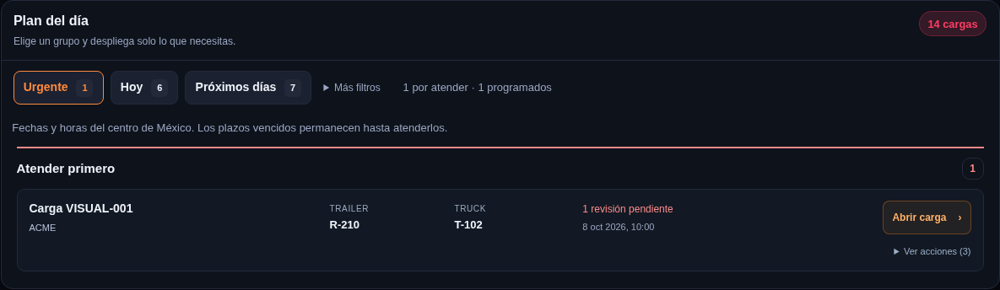
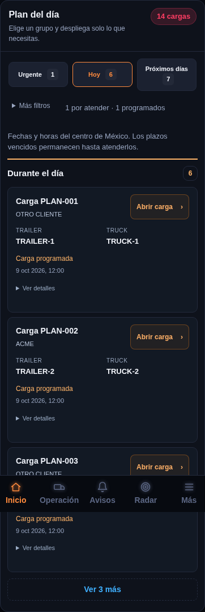

# Campana personal y plan del día compacto

Los avisos de cargas de la campana corresponden únicamente a los clientes asignados a la cuenta que inició sesión. Esta regla es igual para Admin, Supervisor y CSR. Consultar toda la operación, elegir otro CSR o seguir una carga de otro cliente no amplía la campana.

Se aplica a revisiones, avisos al cliente, entregas próximas y avisos del servidor vinculados a cargas. Los apartados requieren identificar una carga del cliente propio; el nombre manual del CSR de VG no concede pertenencia. Las tareas sin carga solo conservan avisos personales si están asignadas expresamente a la cuenta. Las tareas de otro cliente se consultan en su sección, sin añadir avisos de ese cliente a la campana.

Los avisos antiguos de clientes ajenos se retiran de la lista y del contador. Si cambia el CSR de un cliente, el siguiente refresco de asignaciones actualiza la campana. Esto no cambia la consulta general del portal ni las asignaciones guardadas.

El plan del día muestra **un grupo a la vez**: Urgente, Hoy o Próximos días. Al iniciar elige el primer grupo que tenga cargas. Las filas muestran carga, cliente, trailer, truck y el motivo principal. **Abrir carga** abre el expediente; **Ver acciones** despliega los recordatorios y controles. Las acciones empiezan cerradas y mantienen su despliegue durante los refrescos. **Más filtros** permite consultar todas las cargas, las revisiones o los avisos al cliente.

## Instalar esta actualización

Para el panel que ya tiene el lector de Radar corregido:

1. Abre [el HTML actualizado](https://raw.githubusercontent.com/stebanrh-bit/Panel_bajio_supabase_gpt/supabase-inicial/google-apps-script/index-sitio.html), selecciona todo con **Ctrl+A** y copia con **Ctrl+C**.
2. En tu proyecto existente de Google Apps Script, abre **index.html**, reemplaza todo su contenido y guarda.
3. Ve a **Implementar → Administrar implementaciones → lápiz → Nueva versión → Implementar**, usando la misma implementación.
4. Recarga tu enlace habitual con **Ctrl+Shift+R**.

Solo se reemplaza index.html. Esta actualización no requiere SQL. La implementación de Google queda pendiente de estos pasos; no se publica desde las pruebas locales.

## Verificación

Se usan cuentas y datos ficticios, peticiones interceptadas y PostgreSQL temporal. Los resultados están en [la evidencia de esta entrega](evidencia-campana-plan-2026-10-16.json). Las pruebas manuales permanecen canceladas por el usuario.

