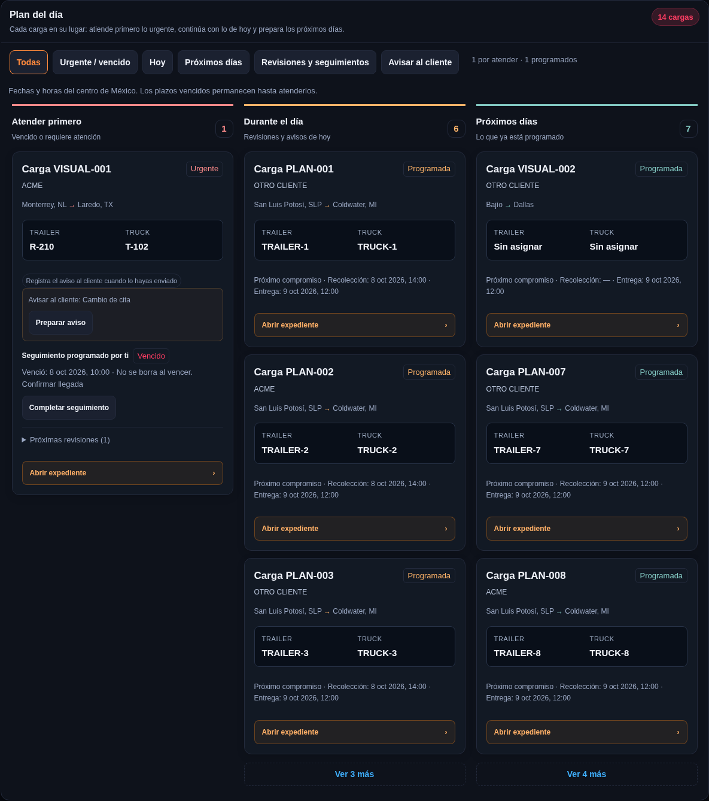
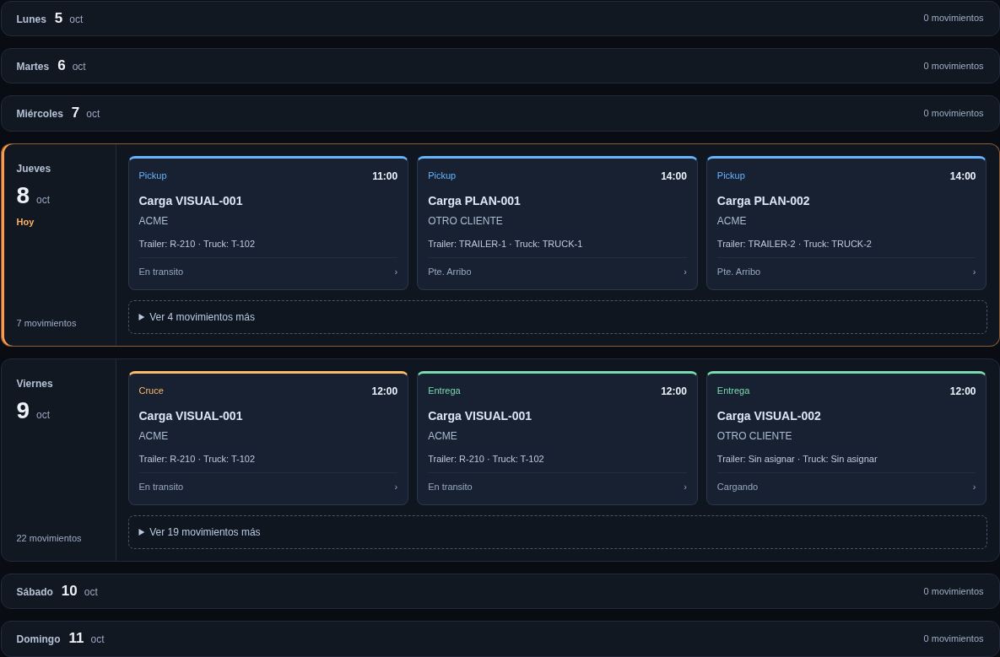
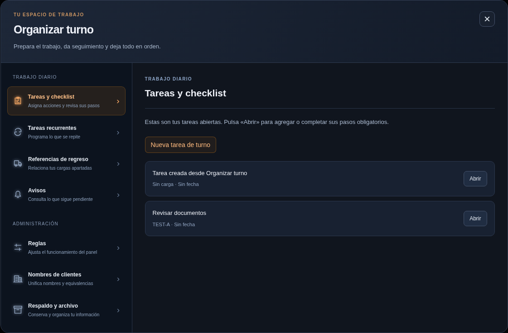

# Plan del día, agenda semanal y Organizar turno

El plan del día separa las cargas en **Atender primero**, **Durante el día** y **Próximos días**. Cada carga aparece una sola vez, en su propia tarjeta, con cliente, ruta, número de trailer y truck. Los equipos sin dato muestran «Sin asignar». Se conservan los avisos al cliente y las acciones independientes de cada recordatorio.

Cada grupo muestra primero tres cargas; «Ver más» despliega el resto. Los filtros de Inicio siguen disponibles y el contador incluye también las cargas que aún no se han desplegado.

El calendario semanal ahora se lee por filas, una por día. Cada movimiento tiene su horario, tipo, carga, cliente y equipo en una tarjeta ancha. Los días con más de tres movimientos permiten desplegar los restantes; los días vacíos ocupan una sola línea. Se conservan los filtros por cliente y tipo, la navegación entre semanas y la apertura del expediente o apartado. La selección de un filtro muestra únicamente los movimientos que coinciden.

Organizar turno tiene un menú con iconos y una sola sección de trabajo visible. Agrupa **Trabajo diario** y, para quienes tienen permiso, **Administración**. Las tareas se presentan en tarjetas con su botón Abrir. En celular, el menú se acomoda en dos columnas encima del contenido. Los formularios de tareas, checklist, programación y reglas conservan su funcionamiento.

## Actualizar Google Apps Script

Para el panel que ya tiene instalado el lector de Radar corregido:

1. Abre [el panel actualizado](https://raw.githubusercontent.com/stebanrh-bit/Panel_bajio_supabase_gpt/supabase-inicial/google-apps-script/index-sitio.html), selecciona todo con **Ctrl+A** y copia con **Ctrl+C**.
2. En el proyecto existente de Google Apps Script, abre **index.html**. Reemplaza todo el contenido y guarda.
3. Ve a **Implementar → Administrar implementaciones → lápiz**. Selecciona **Nueva versión** y pulsa **Implementar**, usando la misma implementación.
4. Abre tu enlace habitual y recarga con **Ctrl+Shift+R**.

Solo se actualiza index.html. Esta entrega no requiere ejecutar SQL ni cambiar los demás archivos de Google.

## Verificación local

La evidencia automática se guarda en [evidencia-diseno-plan-turno-2026-10-16.json](evidencia-diseno-plan-turno-2026-10-16.json). Se usan datos ficticios y peticiones interceptadas; no se modifican registros de producción. La ronda de pruebas manuales permanece cancelada por indicación del usuario. La instalación en el enlace publicado de Google queda pendiente de los pasos anteriores.

