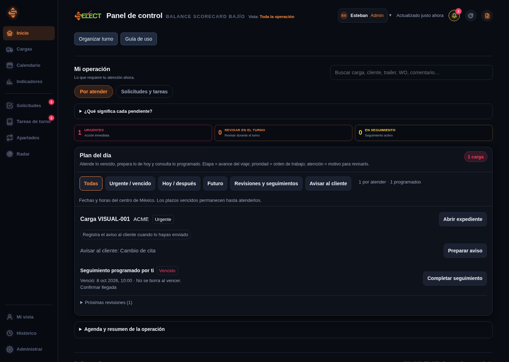
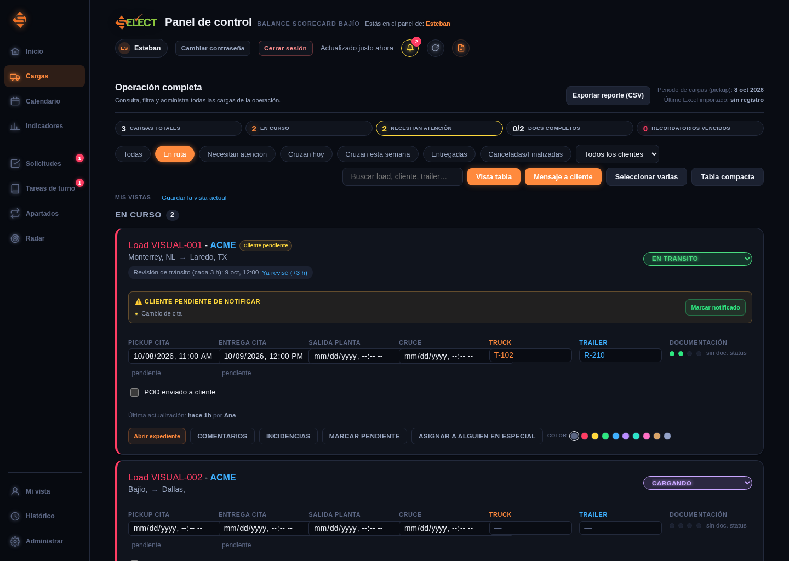

# Publicar la interfaz original con Supabase

Esta entrega reutiliza las tres interfaces originales: panel interno, Portal Cliente y Vista Gerencia. Conserva sus estilos, logos, menú, ventanas y controles. Supabase sigue guardando los datos y las cuentas; Google Apps Script aloja las páginas y consulta Maps. No se necesita crear una hoja de Google Sheets.

La versión publicada de Google todavía no cambia hasta completar estos pasos. El código está preparado en la rama `supabase-inicial`. Las cargas y cuentas existentes se conservan.

## Vista sencilla de Cargas

La entrega más reciente convierte Cargas en una hoja clara y compacta, con filtros en una fila y acciones dentro de **Opciones** o del detalle. Conserva notificaciones, datos y permisos. Requiere actualizar únicamente **index.html**. [Capturas y pasos](VISTA_SENCILLA_2026-10-19.md).

## Vistas del calendario, tareas y listado de cargas

Esta actualización agrega **Agenda, Semana y Lista compacta**, unifica las tareas del detalle y aclara el estado del seguimiento. El listado muestra origen antes de destino, conserva los comentarios y deja la cita de recolección en el detalle. Requiere actualizar únicamente **index.html** si ya instalaste la revisión general. [Cambios y pasos](CALENDARIO_TAREAS_Y_LISTADO_2026-10-16.md).

## Revisión general del panel y Portal Cliente

La revisión más reciente corrige búsqueda, formularios, Histórico, avisos, apertura de turno y respuestas tardías del Portal Cliente. Requiere actualizar **index.html e index-cliente.html**. [Cambios, resultados y pasos](REVISION_GENERAL_2026-10-16.md).

## Campana por cliente y plan compacto

La campana ahora se limita a los clientes de cada cuenta y el plan muestra un grupo a la vez con acciones desplegables. Se actualiza únicamente **index.html**. [Pasos y capturas](CAMPANA_PERSONAL_Y_PLAN_COMPACTO_2026-10-16.md).

## Nuevo diseño del plan, calendario y Organizar turno

Esta actualización requiere reemplazar únicamente **index.html** y publicar una nueva versión de la implementación existente. [Pasos y capturas](DISENO_PLAN_Y_TURNO_2026-10-16.md).

## Actualización del listado sin scroll lateral

Si ya instalaste la corrección del lector de Radar, este ajuste requiere reemplazar únicamente **index.html** y publicar una nueva versión de la implementación existente. [Pasos](LISTADO_SIN_SCROLL_2026-10-16.md).

## Si Radar muestra «Contenido HTML incorrecto»

Actualiza **index.html y lector.html juntos** siguiendo [la corrección del lector](CORRECCION_RADAR_LECTOR_2026-10-16.md). Esta corrección se aplica después de la entrega de las 49 opciones y conserva tu enlace.

## Si ya instalaste las 49 opciones

La guía de un solo archivo siguiente corresponde a la corrección anterior de tareas. Para el error del lector de Radar, utiliza la guía de dos archivos de arriba.

Para corregir la pestaña de tareas vacía y quitar Contactos VG, sigue [esta actualización de un solo archivo](CORRECCION_TAREAS_2026-10-16.md). Los pasos completos de abajo corresponden a una instalación de la entrega completa.

## Archivos completos

Abre cada enlace y usa **Ctrl+A → Ctrl+C** para copiar TODO. No necesitas descargar un ZIP.

1. [Actualización SQL](https://raw.githubusercontent.com/stebanrh-bit/Panel_bajio_supabase_gpt/supabase-inicial/supabase/actualizar_sitio.sql).
2. [Función de cuentas: index.ts](https://raw.githubusercontent.com/stebanrh-bit/Panel_bajio_supabase_gpt/supabase-inicial/supabase/functions/panel-accounts/index.ts).
3. [Código Google: Code-sitio.gs](https://raw.githubusercontent.com/stebanrh-bit/Panel_bajio_supabase_gpt/supabase-inicial/google-apps-script/Code-sitio.gs).
4. [Panel: index-sitio.html](https://raw.githubusercontent.com/stebanrh-bit/Panel_bajio_supabase_gpt/supabase-inicial/google-apps-script/index-sitio.html).
5. [Cliente: index-cliente.html](https://raw.githubusercontent.com/stebanrh-bit/Panel_bajio_supabase_gpt/supabase-inicial/google-apps-script/index-cliente.html).
6. [Gerencia: index-gerencia.html](https://raw.githubusercontent.com/stebanrh-bit/Panel_bajio_supabase_gpt/supabase-inicial/google-apps-script/index-gerencia.html).
7. [Lector: lector.html](https://raw.githubusercontent.com/stebanrh-bit/Panel_bajio_supabase_gpt/supabase-inicial/google-apps-script/lector.html).

El ZIP `entregables/panel-bajio-sitio.zip` contiene estos mismos archivos, las instrucciones y las capturas con datos ficticios.

## 1. Actualizar la base de datos

1. Abre Supabase y entra en **Panel Bajio - supabase**.
2. Abre **SQL Editor → New query**.
3. Copia TODO el archivo del enlace 1, desde el primer comentario hasta el último `commit;`.
4. Pégalo en la consulta nueva y pulsa **Run**.
5. Continúa cuando la consulta termine correctamente.

El archivo reúne SQL 004–012 en una sola transacción y requiere 001, 002 y 003, ya utilizados en tu panel. Se puede repetir sin borrar los registros existentes. No vuelvas a ejecutar SQL 001 y no elimines tablas. Si aparece un error, conserva la página que ya funciona y comparte únicamente el texto del error.

## 2. Instalar la función de cuentas en Supabase

La pantalla original entra con **nombre y contraseña** y permite administrar cuentas. Esta función conecta esos controles con Supabase Auth.

1. En el mismo proyecto Supabase, abre **Edge Functions**.
2. Abre la función existente **panel-accounts**. Si aún no existe, créala con ese nombre usando el editor del Dashboard.
3. Abre su archivo **index.ts**, selecciona todo su contenido y pega TODO el archivo del enlace 2.
4. Guarda y despliega la función.
5. En la configuración de **panel-accounts**, desactiva **Verify JWT** / **Enforce JWT verification** / **Verify JWT with legacy secret**, según el nombre que muestre tu Dashboard. Guarda el ajuste.

Ese ajuste permite abrir el login antes de iniciar sesión. Las acciones privadas verifican el JWT y el rol dentro de la función; crear cuentas, restablecer contraseñas y desbloquear usuarios exige administración. La función utiliza las variables internas que Supabase proporciona automáticamente. No copies ninguna clave `service_role` al HTML ni al chat.

Para desarrolladores, el equivalente es:

```bash
supabase functions deploy panel-accounts --project-ref pwqibuunekrzfcztcfju --no-verify-jwt
```

La cuenta Esteban conserva su contraseña actual de Supabase. La contraseña para abrir **Gestionar CSR** es la de esa misma cuenta administradora. Ya no se usa una contraseña compartida en las propiedades de Google.

## 3. Copiar los archivos al proyecto Google existente

1. Abre **script.google.com** y entra al proyecto de nuestro panel.
2. Abre **Code.gs**. Selecciona todo y pega TODO el archivo del enlace 3. El nombre en Google sigue siendo **Code.gs**.
3. Abre **index.html**. Selecciona todo y pega TODO el archivo del enlace 4. El nombre en Google sigue siendo **index**.
4. Pulsa **+ → HTML** y crea **index-cliente**. Pega TODO el enlace 5. Si ya existe, reemplaza su contenido.
5. Crea del mismo modo **index-gerencia** y pega TODO el enlace 6.
6. Crea **lector** y pega TODO el enlace 7. Es un HTML generado que contiene el lector como datos; copia el documento completo. Google lo guarda como `lector.html`.
7. Guarda los cinco archivos: **Code.gs**, **index.html**, **index-cliente.html**, **index-gerencia.html** y **lector.html**.

Las vistas ahora están separadas y el lector se carga solo cuando se usa. Los HTML son archivos generados y comprimidos; las fuentes legibles y comentadas están en `web/src/original/`. No copies fragmentos ni agregues etiquetas al lector. El antiguo `Code.gs` de la raíz del repositorio pertenece a la versión con Sheets; para esta instalación se usa **Code-sitio.gs**.

## 4. Activar una nueva versión en el mismo enlace

1. Pulsa **Implementar → Administrar implementaciones**.
2. Selecciona la aplicación web del panel y pulsa el **lápiz**.
3. En **Versión**, selecciona **Nueva versión**.
4. Conserva **Ejecutar como: Yo** y el acceso de tu implementación actual.
5. Pulsa **Implementar**. Completa la autorización de Google si la solicita.
6. Abre tu enlace habitual terminado en **/exec** y actualiza la página.

Editar esa implementación conserva el enlace. No se usa Netlify ni se requiere mantener Codex abierto.

Si las consultas de mapas solicitan autorización y la página no muestra el diálogo, ejecuta `autorizarServiciosGoogle_` desde el editor de Apps Script, autoriza con tu cuenta y vuelve al panel.

## Las tres páginas

- **Panel interno:** tu enlace habitual `/exec`.
- **Portal Cliente:** el mismo enlace con `?portal=cliente` al final.
- **Vista Gerencia:** el mismo enlace con `?portal=gerencia` al final.

En **Gestionar CSR** puedes crear personas y asignarles una contraseña. Si no indicas correo, Supabase usa una dirección interna; la recuperación de esas cuentas la hace administración. También puedes crear/editar usuarios del Portal Cliente y configurar el acceso de la Vista Gerencia.

## Después de instalar

**Entrega de las 49 opciones:** esta actualización requiere el SQL completo, volver a desplegar `panel-accounts` y actualizar los cinco archivos Google indicados arriba. No basta con cambiar únicamente `index.html`. [Cambios y funcionamiento](ENTREGA_49_OPCIONES.md) · [Manual por rol](MANUAL_POR_ROL.md).

El proceso de millas horario también generará tareas y avisos internos después de actualizar SQL y Code. Si lo detienes, puedes ejecutar `activarTareasTurno` desde el editor para dar a las tareas su propio activador horario. No activa correo ni retención automática. Los cambios inferiores corresponden a entregas históricas y no sustituyen estos pasos.


**Notas de entregas anteriores (no usar como actualización parcial de esta entrega):**

La mejora de [Inicio y recordatorios](INICIO_Y_RECORDATORIOS.md) organiza la información y explica cada plazo. Si ya instalaste el sitio, actualiza solo `index.html` y activa una nueva versión Google.

La revisión del 14 de octubre corrigió la lectura de archivos con encabezados en la primera fila y habilitó CSV en el selector. Si ya instalaste el sitio, solo actualiza `index.html` y activa una nueva versión de Google. [Resultados y pasos](REVISION_COMPLETA_2026-10-14.md).

Para usar Esteban también como CSR y comprobar el Portal Cliente, sigue [ADMINISTRADOR_Y_CSR.md](ADMINISTRADOR_Y_CSR.md). Si ya instalaste esta entrega, ese ajuste solo requiere actualizar el HTML de Google.

Seguiremos [PRUEBAS_FINALES.md](PRUEBAS_FINALES.md), una prueba por vez. Las pruebas con otras cuentas quedan para la última etapa, como acordamos. Las comprobaciones de esta entrega están en [VALIDACION_49_OPCIONES.md](VALIDACION_49_OPCIONES.md); VALIDACION_SITIO.md conserva el registro histórico.





## Millas Google automáticas

Si ya tienes el proceso de millas activo, conserva su activador y secreto. Para una primera activación, sigue [MILLAS_GOOGLE_AUTOMATICAS.md](MILLAS_GOOGLE_AUTOMATICAS.md) para vincular y activar el procesamiento por hora. La instalación histórica solo de SQL 010 no incluye las 49 opciones; para esta entrega completa los pasos 1–4 de arriba. Instalar el SQL por sí solo no crea un activador en Google.
