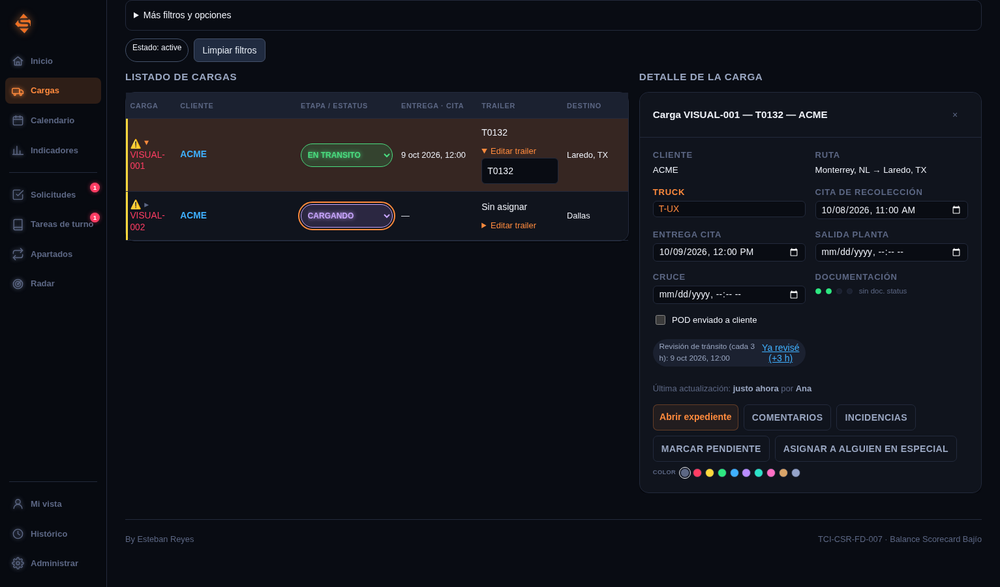

# Cargas: listado sin desplazamiento lateral

Las columnas ahora comparten el espacio disponible. Los clientes, destinos, fechas y trailers permiten varias líneas. En escritorio, la lista conserva el detalle lateral; en pantallas pequeñas agrupa los campos con etiquetas y mantiene los encabezados para ordenar. Se conserva la edición del trailer, la apertura de cargas y los filtros.

## Instalar en el mismo enlace

Esta actualización corresponde al panel que ya tiene instalado el lector de Radar corregido.

1. Abre [index-sitio.html actualizado](https://raw.githubusercontent.com/stebanrh-bit/Panel_bajio_supabase_gpt/supabase-inicial/google-apps-script/index-sitio.html) y copia todo con Ctrl+A → Ctrl+C.
2. En el proyecto Google Apps Script existente, abre **index.html**, reemplaza todo su contenido y guarda.
3. Ve a **Implementar → Administrar implementaciones → lápiz**, selecciona **Nueva versión** y pulsa **Implementar**, conservando la implementación actual.
4. Abre el enlace habitual y pulsa **Ctrl+Shift+R**.

Este ajuste solo requiere index.html. El lector de Radar, Code.gs y Supabase conservan sus versiones actuales.

## Verificación automática

145 pruebas del proyecto aprobadas. El navegador comprobó 26 combinaciones: con y sin detalle abierto, a 1920, 1533, 1440, 1280, 1180, 1100, 1050, 1024, 820, 768, 390, 360 y 320 px. El contenido cabe en el listado y en la página; no se oculta un desbordamiento. T0132 sigue siendo legible en su editor en los 13 tamaños. La edición, la navegación y las importaciones CSV/XLSX/XLS completaron sus flujos sin errores JS.

La comparación exacta de otra ventana (Nueva solicitud) detectó una diferencia pequeña en una insignia del menú. Se registra por separado en la evidencia y no se afirma aprobada la batería de comparación exacta de esta revisión.

[Medidas y resultados](evidencia-listado-sin-scroll-2026-10-16.json). La ronda de pruebas manuales sigue cancelada por indicación del usuario.

