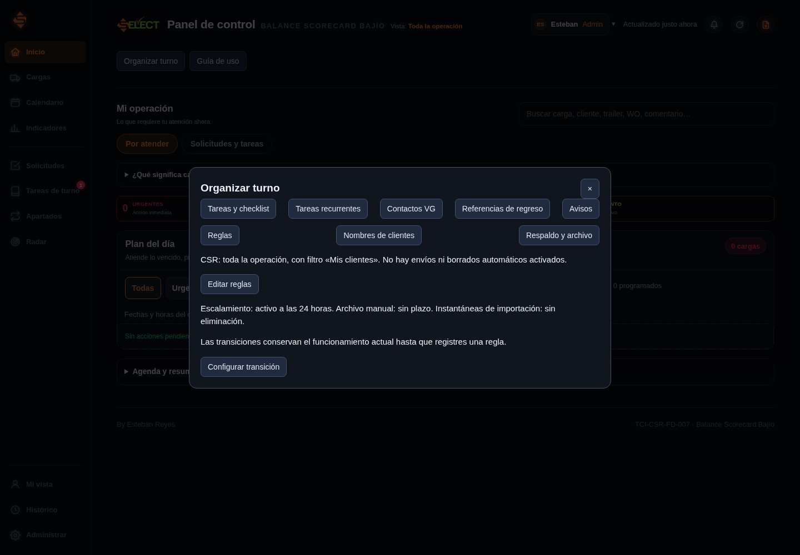

# Validación de la entrega de 49 opciones

Fecha: 16 de octubre de 2026. Base de trabajo: `f77366f`, rama `supabase-inicial`. Actualizada después de la corrección de la pestaña de tareas vacía y la retirada de Contactos VG. Esta validación no instaló cambios en el Supabase ni en la implementación Google del usuario.

## Resultados locales

| Comprobación | Resultado |
| --- | --- |
| `npm --prefix web test` | 145 pruebas aprobadas; 0 fallidas, omitidas o canceladas. Incluye PostgreSQL efímero, permisos, versiones y restauración. |
| `npm --prefix web run build` | Compila panel interno, cliente, gerencia y lector. |
| `python scripts/package_site.py --check` | Verifica correspondencia exacta entre SQL 004–012, los cuatro archivos HTML generados y el contenido del ZIP. |
| `node scripts/check_browser.mjs --legacy-xls` | 38 comparaciones de pantallas/ventanas; flujo de incidencia, cierre de sesión, Admin como CSR, CSV/XLSX/XLS, recordatorios independientes y móvil. Sin errores JS. |
| `node scripts/check_organization_browser.mjs` | 8 flujos con SDK real y PostgreSQL efímero: pestaña vacía con mensaje y sin Contactos VG, creación desde Organizar turno, checklist, pasos completados, recurrencia, configuración sin envío externo, Mis clientes/limpiar y texto adverso sin ejecución HTML. |
| Deno check de `panel-accounts/index.ts` | Tipos correctos usando caché local y `--no-remote`. |
| `node scripts/measure_queries.mjs` | EXPLAIN antes/después guardado con 100 cargas, 50 100 cambios y 10 000 rutas sintéticas. |
| Integridad de fuentes originales | `Code.gs`, `PanelScript.html`, `PanelEstilos.html` e `index.html` de la raíz se conservan. |

Las comparaciones visuales enfrentan la presentación prevista de las fuentes con los archivos de entrega, usando datos de prueba independientes. No prueban identidad con una sesión autenticada del sitio original en producción. Las nuevas ventanas se comprueban por sus acciones y por los registros que guardan en PostgreSQL local.

La batería de base de datos verifica consulta general del CSR, altas/cambios/salidas incrementales, incidencias, checklist obligatorio, dependencias sin ciclos, privacidad de tareas, recurrencia sin duplicados, destinatarios de escalamiento, vigencia de avisos, seguimiento con POD pendiente, alias con preservación histórica, cancelación con motivo, retiro de apartados cerrados, retención manual y migraciones repetibles.

El ensayo de respaldo exporta las tablas permitidas y las restaura en otra base efímera con claves foráneas. Incluye rutas, lugares, preferencias, contactos, programaciones, pasos y cierres. Simula identidades; no restaura contraseñas ni sesiones de Supabase Auth. Rechaza un respaldo con recuentos inconsistentes.

## Tamaño y consultas

El HTML interno se redujo aproximadamente un **57 %** frente a los 1 920 975 bytes de la entrega base; los tamaños actuales exactos están en evidencia-entrega-49.json. Cliente y gerencia pesan aproximadamente 293 y 291 kB; el lector de 71 kB se solicita al usarlo. Los tamaños gzip son estimaciones locales. El empaquetado autónomo para Google conserva un paquete interno mayor de 500 kB; Vite lo informa como advertencia, con compilación correcta.

En la muestra EXPLAIN, el costo estimado de consultar una página de historial pasa de 1237,45 a 91,85 y el de rutas por origen de 321,57 a 175,36. Se conservan los planes completos. Es una comparación local de esas consultas; no mide cuotas, latencia ni concurrencia de producción.

Las revisiones agregan escritura y un bloqueo transaccional para ordenar cambios. Los índices y nuevas tablas ocupan espacio. La retención comienza sin periodos y no corre automáticamente. No se promete un porcentaje de ahorro de Supabase a partir del tamaño del HTML.

## Evidencia y reproducción

- [Registro por cada opción](IMPLEMENTACION_49_OPCIONES.json).
- [Pantallas y medidas de trailer/móvil](evidencia-visual-49.json).
- [Flujos nuevos y persistencia](evidencia-organizacion-49.json).
- [Planes de consulta](evidencia-consultas-49.json).
- [Tamaños de entrega](evidencia-entrega-49.json).
- [Código activo y comandos](CODIGO_ACTIVO.md).

GitHub Actions queda configurado para instalar con lockfile, ejecutar pruebas, compilar y verificar el paquete. Su ejecución remota se revisa en GitHub después de subir el cambio; el resultado local no se presenta como un resultado remoto de CI.

## Pendiente en el sitio publicado

Seguir [INSTALAR_SITIO.md](INSTALAR_SITIO.md): SQL completo, volver a desplegar la función de cuentas y actualizar los cinco archivos Google. Crear una nueva versión de la implementación existente conserva el enlace.

Después seguir [PRUEBAS_FINALES.md](PRUEBAS_FINALES.md), una prueba por vez. Ahí se comprueban autorizaciones y activadores de Google, red y cuotas reales, otras cuentas, cliente y gerencia. El envío externo permanece apagado hasta elegir canal; no se agregó un proveedor ni un remitente. Las reglas de transición y el escalamiento empiezan sin imponer una política nueva.

## Corrección del lector del Radar

Se corrigió el transporte de lector.html por HtmlService: HTML válido con JSON, extracción del programa antes de iniciar el Worker y errores legibles. La prueba `check_organization_browser.mjs --reader-files` comprueba adicionalmente XLSX y XLS con el puente Google simulado, archivos reales y PostgreSQL efímero. Se elimina la copia local antes de recargar, para verificar la recuperación desde la base. La cuenta Google real y la instalación de la corrección no se validan desde este entorno. [Evidencia](evidencia-radar-lector-2026-10-16.json) · [Instalación de dos archivos](CORRECCION_RADAR_LECTOR_2026-10-16.md).

## Listado de Cargas sin desplazamiento lateral

Las 145 pruebas del proyecto aprobaron con el nuevo diseño. El flujo funcional de navegador aprobó 26 medidas del listado (13 anchos, con y sin detalle), T0132 legible, edición persistente, navegación e importación CSV/XLSX/XLS. El contenedor utiliza overflow visible: se comprueba que el contenido cabe, sin esconder un desbordamiento con CSS.

La ejecución de comparación exacta se detuvo en Nueva solicitud por una diferencia de 253 píxeles localizada en una insignia lateral, fuera del listado modificado. No se presenta esa ejecución como 38 comparaciones aprobadas de esta revisión; el registro anterior es histórico. Las medidas y la nota visual están en [la evidencia del listado](evidencia-listado-sin-scroll-2026-10-16.json). [Actualización de un solo HTML](LISTADO_SIN_SCROLL_2026-10-16.md).
